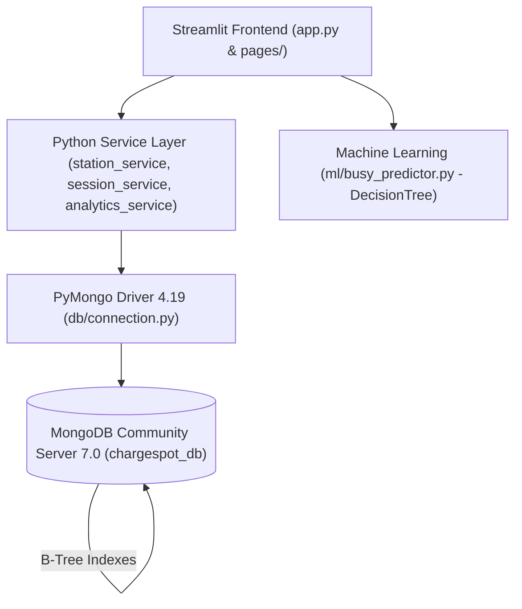
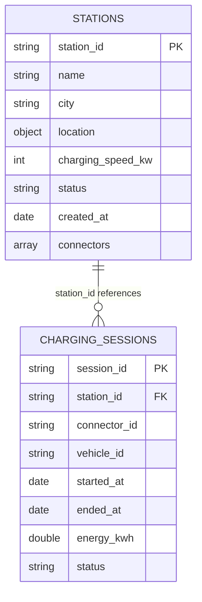

# ChargeSpot: EV Charging Availability and Usage Analytics System
## Academic Project Report — CSE494: Intelligent NoSQL Databases

---

## 1. Executive Summary & Problem Formulation

Electric mobility is experiencing exponential growth, yet EV adoption is frequently constrained by "charging anxiety"—the uncertainty of whether a charging station has working and available plugs upon arrival.

Traditional relational database models face structural bottlenecks when representing EV charging networks due to the rigid tabular format of stations, heterogeneous connector standards (e.g., CCS2, Type 2, CHAdeMO, GB/T), dynamic real-time status transitions, and unbounded historical session telemetry.

**ChargeSpot** is an intelligent NoSQL database management platform engineered using **MongoDB**, **PyMongo**, and **Streamlit**. It solves these challenges by combining:
1. **Hybrid Document Modeling:** High-speed embedded documents for station hardware and referenced collections for unbounded session logs.
2. **Database-Level Integrity:** MongoDB collection-level `$jsonSchema` validation rules ensuring data hygiene at write time.
3. **Advanced NoSQL Analytics:** Multi-stage aggregation pipelines (`$match`, `$unwind`, `$group`, `$sort`, `$project`, `$lookup`) delivering real-time network intelligence without offloading processing to application memory.
4. **Explainable Machine Learning:** An explainable `DecisionTreeClassifier` predicting station congestion to assist driver trip planning without compromising academic integrity.

---

## 2. System Architecture & Tech Stack Justification



### Technology Selection Rationale
- **MongoDB 7.0:** Provides flexible BSON document storage, native array manipulation operators (`$`, `$push`), collection-level schema validation, and expressive aggregation pipelines.
- **PyMongo 4.19:** Official, thread-safe Python driver for MongoDB, handling connection pooling, cursor iteration, and BSON serialization.
- **Streamlit 1.66:** Delivers a reactive, single-language web interface directly bound to database state, avoiding REST API boilerplate.
- **Plotly Express & Pandas:** Lightweight visualization and tabular formatting layer for aggregation pipeline outputs.
- **scikit-learn 1.9:** Provides the `DecisionTreeClassifier` with explainable decision rules and feature importances.

---

## 3. MongoDB Document Design & Data Modeling

### 3.1 Collections Overview
The database `chargespot_db` contains two primary collections:
1. `stations`: Stores charging station metadata and embedded connector arrays.
2. `charging_sessions`: Stores time-series charging session events referencing stations.



### 3.2 Design Decision: Embedded vs. Referenced Relationships

| Entity Relationship | Modeling Pattern | Academic Justification |
| :--- | :--- | :--- |
| **Station ➔ Connectors** | **Embedded Array** (`1:Few`) | Each station has a fixed, bounded number of plugs (typically 2 to 5). Connectors are always read and displayed together with the station. Embedding eliminates expensive joins during search queries and guarantees atomic updates via `update_one({"connectors.connector_id": ...})`. |
| **Station ➔ Charging Sessions** | **Referenced Collection** (`1:Many`, Unbounded) | A busy station can accumulate tens of thousands of sessions over time. Embedding sessions inside the station document would rapidly breach MongoDB's **16 MB BSON document size limit** and cause severe memory bloat. Normalizing sessions into a distinct collection allows independent indexing, filtering, and scalable aggregation. |

### 3.3 Sample Documents

#### `stations` Document:
```json
{
  "_id": {"$oid": "6ae2ddb04ae46060caa3c9ce"},
  "station_id": "CS001",
  "name": "Campus North Charging Hub",
  "city": "Phagwara",
  "location": {
    "city": "Phagwara",
    "area": "University North Campus",
    "address": "Gate 1, Academic Avenue"
  },
  "connector_type": "CCS2",
  "charging_speed_kw": 60,
  "status": "operational",
  "created_at": {"$date": "2026-01-15T10:00:00.000Z"},
  "connectors": [
    {
      "connector_id": "C1",
      "connector_type": "CCS2",
      "power_kw": 60.0,
      "price_per_kwh": 14.50,
      "status": "available"
    },
    {
      "connector_id": "C2",
      "connector_type": "CCS2",
      "power_kw": 60.0,
      "price_per_kwh": 14.50,
      "status": "occupied"
    },
    {
      "connector_id": "C3",
      "connector_type": "Type 2",
      "power_kw": 22.0,
      "price_per_kwh": 11.00,
      "status": "available"
    },
    {
      "connector_id": "C4",
      "connector_type": "Type 2",
      "power_kw": 22.0,
      "price_per_kwh": 11.00,
      "status": "out_of_service"
    }
  ]
}
```

#### `charging_sessions` Document:
```json
{
  "_id": {"$oid": "6ae2ddb04ae46060caa3c9e2"},
  "session_id": "SESS-1001",
  "station_id": "CS001",
  "connector_id": "C2",
  "vehicle_id": "EV-NEXON-01",
  "started_at": {"$date": "2026-10-28T11:30:00.000Z"},
  "ended_at": null,
  "energy_kwh": 12.4,
  "status": "in_progress"
}
```

---

## 4. Collection-Level `$jsonSchema` Validation

To guarantee database integrity independent of application code, collection-level validation rules were enforced using MongoDB's `$jsonSchema` engine via `collMod`.

### 4.1 Schema Definition Excerpt (`db/validators.py`)
```python
STATION_SCHEMA = {
    "$jsonSchema": {
        "bsonType": "object",
        "required": ["station_id", "name", "city", "location", "connectors", "status", "created_at"],
        "properties": {
            "station_id": {"bsonType": "string"},
            "charging_speed_kw": {
                "bsonType": ["double", "int", "long"],
                "minimum": 1
            },
            "status": {
                "enum": ["operational", "maintenance", "closed"]
            },
            "connectors": {
                "bsonType": "array",
                "minItems": 1,
                "items": {
                    "bsonType": "object",
                    "required": ["connector_id", "connector_type", "power_kw", "price_per_kwh", "status"],
                    "properties": {
                        "connector_type": {"enum": ["CCS2", "Type 2", "CHAdeMO", "GB/T"]},
                        "power_kw": {"bsonType": ["double", "int", "long"], "minimum": 1},
                        "price_per_kwh": {"bsonType": ["double", "int", "long"], "minimum": 0},
                        "status": {"enum": ["available", "occupied", "out_of_service"]}
                    }
                }
            }
        }
    }
}
```

### 4.2 Proof of Validation Rejection
An invalid test record violating multiple constraints (negative charging speed: `-50`, invalid status enum: `"not_a_valid_status"`, and empty connectors array: `[]`) was submitted to MongoDB:
```python
invalid_station = {
    "station_id": "CS_INVALID_001",
    "charging_speed_kw": -50,
    "status": "not_a_valid_status",
    "connectors": []
}
```
**Database Engine Output:**
```text
WriteError: Document failed validation
```
Verified in test suite (`tests/test_crud.py`):
```text
--- TEST 1: Demonstrating $jsonSchema Validation Rejection ---
Attempting to insert document with negative speed and invalid enum...
Result: Success=False, Message='Validation failed: Document failed validation'
✓ PASSED: MongoDB schema validation successfully rejected the malformed document.
```

---

## 5. CRUD Operations Implementation

All four core database operations are implemented through modular service functions in `services/station_service.py` and `services/session_service.py`.

### 5.1 Create (`insert_one`)
```python
def create_station(station_data):
    try:
        res = db.stations.insert_one(station_data)
        return True, f"Station '{station_data['station_id']}' added successfully."
    except DuplicateKeyError:
        return False, "Station ID already exists."
    except WriteError as e:
        return False, f"Validation failed: {e.details.get('errmsg')}"
```

### 5.2 Read (`find`, `find_one`)
```python
def search_stations(search_text=None, city=None, status=None, connector_type=None, min_speed=None):
    query = {}
    if search_text:
        regex = {"$regex": search_text, "$options": "i"}
        query["$or"] = [{"station_id": regex}, {"name": regex}, {"location.area": regex}]
    if city and city != "All":
        query["city"] = city
    if min_speed:
        query["charging_speed_kw"] = {"$gte": min_speed}
    return list(db.stations.find(query).sort("station_id", 1))
```

### 5.3 Update (`update_one` with Array Positional Operator `$`)
Modifying an individual connector's status within the embedded array requires the MongoDB `$` positional operator, which targets the specific element matched in the query condition:
```python
def update_connector_status(station_id, connector_id, new_status):
    result = db.stations.update_one(
        {"station_id": station_id, "connectors.connector_id": connector_id},
        {"$set": {"connectors.$.status": new_status}}
    )
    return result.matched_count > 0
```

### 5.4 Delete (`delete_one` with Referential Integrity Guard)
Before executing a deletion, the system queries the `charging_sessions` collection. If in-progress sessions are linked to the station, deletion is safely blocked:
```python
def delete_station(station_id):
    active_count = db.charging_sessions.count_documents({
        "station_id": station_id,
        "status": "in_progress"
    })
    if active_count > 0:
        return False, f"Cannot delete station: {active_count} active session(s) ongoing."
    result = db.stations.delete_one({"station_id": station_id})
    return result.deleted_count > 0
```

---

## 6. MongoDB Aggregation Pipelines

Aggregation pipelines perform multi-stage data processing directly inside the MongoDB database engine.

### Pipeline 1: Count Connectors by Status
- **Business Purpose:** Computes real-time network availability across all stations for the home dashboard donut chart.
- **Stages:**
  1. `$unwind`: Unpacks the embedded `connectors` array into individual documents.
  2. `$group`: Groups by `connectors.status` and calculates `{"$sum": 1}`.
  3. `$project`: Formats fields cleanly.
  4. `$sort`: Orders by count descending.
- **MongoDB Output:**
  ```text
  Status: available       Count: 20
  Status: out_of_service  Count: 7
  Status: occupied        Count: 6
  ```

### Pipeline 2: Energy Consumption by Station (with `$lookup`)
- **Business Purpose:** Calculates total and average kWh delivered by each station and joins station names from the `stations` collection.
- **Stages:**
  1. `$match`: Filters for `{"status": "completed"}` sessions.
  2. `$group`: Groups by `station_id`, sums `energy_kwh`, computes average energy, and counts sessions.
  3. `$lookup`: Left outer join to `stations` on `localField: "_id"`, `foreignField: "station_id"`.
  4. `$unwind`: Flattens the joined `station_info` array.
  5. `$project`: Shapes fields and applies `$round` to 2 decimal places.
  6. `$sort`: Orders descending by `total_energy_kwh`.
- **MongoDB Output:**
  ```text
  [CS004] BMC Chowk EcoStation        Total: 247.97 kWh | Avg: 31.00 kWh | Sessions: 8
  [CS003] Model Town Supercharge      Total: 187.30 kWh | Avg: 37.46 kWh | Sessions: 5
  [CS005] Sarabha Nagar EV Pod        Total: 169.83 kWh | Avg: 33.97 kWh | Sessions: 5
  [CS007] Heritage Walk Green Station Total: 160.91 kWh | Avg: 32.18 kWh | Sessions: 5
  [CS008] Ranjit Avenue SpeedCharger  Total: 151.69 kWh | Avg: 37.92 kWh | Sessions: 4
  ```

### Pipeline 3: Station Utilization Ranking
- **Business Purpose:** Identifies the top charging hubs based on session volume.
- **Stages:** `$group` ➔ `$lookup` ➔ `$unwind` ➔ `$sort` (by session count) ➔ `$limit: 8`.
- **MongoDB Output:**
  ```text
  #1 [CS004] BMC Chowk EcoStation        Sessions: 9
  #2 [CS003] Model Town Supercharge      Sessions: 6
  #3 [CS007] Heritage Walk Green Station Sessions: 6
  #4 [CS005] Sarabha Nagar EV Pod        Sessions: 6
  #5 [CS008] Ranjit Avenue SpeedCharger  Sessions: 5
  ```

### Pipeline 4: Session Status Breakdown
- **Stages:** `$group` on `status` with sum of sessions and energy delivered.
- **MongoDB Output:**
  ```text
  Status: completed    Sessions: 34  Energy: 1145.85 kWh
  Status: in_progress  Sessions: 6   Energy: 107.90 kWh
  Status: cancelled    Sessions: 2   Energy: 3.07 kWh
  ```

---

## 7. Database Indexing & Query Optimization

Indexes store a small portion of the collection's data set in an easy-to-traverse B-tree structure, converting expensive full collection scans (`COLLSCAN`) into efficient index scans (`IXSCAN`).

### 7.1 Created Indexes
- `stations`: Unique index on `station_id` (enforces uniqueness and accelerates point lookups); secondary indexes on `city` and `status`.
- `charging_sessions`: Unique index on `session_id`; secondary indexes on `station_id`, `status`, and `started_at`.

### 7.2 Execution Plan Analysis via `explain()`
Query: `db.stations.find({"station_id": "CS001"}).explain()`

**MongoDB Query Planner Output:**
```json
{
  "queryPlanner": {
    "winningPlan": {
      "stage": "FETCH",
      "inputStage": {
        "stage": "IXSCAN",
        "keyPattern": { "station_id": 1 },
        "indexName": "station_id_1",
        "isMultiKey": false,
        "isUnique": true
      }
    }
  }
}
```
**Technical Interpretation:**
1. The query optimizer selected `IXSCAN` (Index Scan) using the `station_id_1` B-tree index rather than scanning every document in the collection (`COLLSCAN`).
2. The index returned the exact document disk pointer (`RecordId`), which the `FETCH` stage then retrieved in $O(\log N)$ time complexity.

---

## 8. Machine Learning Feature: Station Congestion Predictor

### 8.1 Model Design
- **Algorithm:** scikit-learn `DecisionTreeClassifier` (bounded to `max_depth=4` for explainability).
- **Dataset:** 600 synthetic charging observations reflecting real-world commuting spikes and weekend travel behaviors.
- **Train/Test Split:** 75% training (450 samples), 25% test (150 samples) with stratified splitting on the target label.
- **Evaluation Metric:** Achieves **91.3% Accuracy** on unseen test data.

### 8.2 Input Features & Target Label
| Feature | Type | Range / Description |
| :--- | :--- | :--- |
| `hour_of_day` | Integer | 0 to 23 (Hour of arrival) |
| `is_weekend` | Binary | 1 = Saturday/Sunday, 0 = Weekday |
| `charging_speed_kw` | Numeric | 22 to 150 kW (Hardware power) |
| `total_connectors` | Integer | 2 to 5 (Physical bay capacity) |
| `is_peak_hours` | Binary | 1 = 09:00-12:00 or 17:00-20:00 |
| **`is_busy`** (Target) | Binary | **1 = High Congestion**, **0 = Available / Normal** |

### 8.3 Academic Safeguard
The ML model predicts statistical probability of demand based on historical patterns. The model **never overwrites or alters** actual live connector statuses in MongoDB.

---

## 9. Test Verification Matrix

| Test ID | Test Target | PyMongo / Mongo Operation | Expected Outcome | Status |
| :--- | :--- | :--- | :--- | :--- |
| **TC-01** | Schema Validation | `insert_one` (negative speed) | Rejected with `WriteError` | **PASSED** |
| **TC-02** | Station Creation | `insert_one` (`CS999`) | Success message & document stored | **PASSED** |
| **TC-03** | Station Retrieval | `find_one({"station_id": "CS999"})` | Document retrieved matching ID | **PASSED** |
| **TC-04** | Station Update | `update_one` (`$set`) | Speed updated to 120 kW | **PASSED** |
| **TC-05** | Session Start Sync | `start_charging_session` | Plug C1 marked `occupied` | **PASSED** |
| **TC-06** | Referential Guard | `delete_station("CS999")` | Blocked: active session ongoing | **PASSED** |
| **TC-07** | Session End Sync | `end_charging_session` | Plug C1 reverted to `available` | **PASSED** |
| **TC-08** | Station Cleanup | `delete_one("CS999")` | Deleted successfully | **PASSED** |
| **TC-09** | Index Verification | `explain()` on `station_id` | `IXSCAN` winning plan | **PASSED** |
| **TC-10** | Aggregations | 5 Aggregation Pipelines | Correct counts & totals | **PASSED** |

---

## 10. Live Viva Demonstration Script

1. **Launch Application:**
   ```bash
   streamlit run app.py
   ```
2. **Dashboard Overview (`app.py`):**
   - Point out the 5 network KPI cards (33 total connectors, 20 available, 6 occupied, 7 out of service).
   - Show the interactive Plotly Donut chart reflecting real-time connector distribution.
3. **Multi-Parameter Search (`pages/1_Find_a_Station.py`):**
   - Filter by City (e.g. `Jalandhar`) and minimum speed (e.g. `50 kW`).
   - Expand a station card to demonstrate connector details (tariffs, standards).
4. **CRUD & Schema Demonstration (`pages/2_Manage_Stations.py`):**
   - Open Tab 2 ("Add Station") and attempt to insert a station with empty fields or negative power to demonstrate validation rejection.
   - Insert a valid station (`CS011`), verify it appears in Tab 1 ("All Stations").
   - Open Tab 3 ("Edit & Availability") and toggle connector status using the `$` positional operator.
5. **Session Lifecycle & Synchronization (`pages/3_Charging_Sessions.py`):**
   - Open Tab 2 ("Start New Session"), select an available plug, and start a session.
   - Switch back to `app.py` or `Find a Station` to show that the connector immediately turned **Occupied** (Amber).
   - Go to Tab 1 ("Active Sessions"), enter `25.5` kWh, and click "Complete & Free Plug".
   - Show that the plug reverted back to **Available** (Green) and energy was added to total metrics.
6. **NoSQL Aggregations & Machine Learning (`pages/4_Insights.py`):**
   - Explain the multi-stage aggregation pipeline calculating energy consumption per station.
   - Switch to the ML tab: choose a station, set Sunday at 18:00, click "Predict Station Congestion", and explain the decision tree's output logic.

---

## 11. Viva Questions & Model Answers

### Q1: Why did you choose MongoDB over a relational database like MySQL for ChargeSpot?
**Answer:** EV charging stations possess hierarchical and variable data. Each station contains multiple connectors with differing power ratings, tariffs, and status flags. In MongoDB, connectors are naturally embedded as an array of subdocuments within the station document. This matches the application's domain access pattern, avoids expensive relational multi-table JOINs, and allows atomic status updates via array operators.

### Q2: What is the difference between embedding and referencing in MongoDB? When did you use each?
**Answer:** Embedding stores related data within the same document, while referencing stores an identifier pointing to a document in another collection. We embedded connectors inside stations because connector count is small (2–5) and strictly bounded. We referenced charging sessions in a separate collection because session logs grow indefinitely; embedding them inside the station would violate MongoDB's 16 MB document limit and degrade query performance.

### Q3: How did you implement schema validation if MongoDB is schema-less?
**Answer:** While MongoDB does not require fixed schemas by default, it supports collection-level validation rules using `$jsonSchema`. We registered schema validators via the `collMod` command in `db/validators.py`. It enforces BSON types, required keys, minimum numerical thresholds (e.g., speed > 0, energy >= 0), and allowed enum strings (e.g., status must be `operational`, `maintenance`, or `closed`). Any write violating these rules is rejected with a `WriteError`.

### Q4: Explain the `$unwind` aggregation stage and where you used it.
**Answer:** `$unwind` deconstructs an array field from input documents to output a distinct document for each element in the array. We used it in Pipeline 1 and Pipeline 5: since `connectors` is an array inside each station document, `$unwind: "$connectors"` creates a stream of individual connector documents, which are subsequently aggregated by `connectors.status` or `connectors.connector_type` using `$group`.

### Q5: What is the purpose of `$lookup` in MongoDB?
**Answer:** `$lookup` performs a left outer join to an unsharded collection in the same database. In Pipeline 2, we grouped charging sessions by `station_id` to sum energy consumption. We then used `$lookup` with the `stations` collection to join and retrieve the human-readable station `name` and `city` corresponding to that `station_id`.

### Q6: How does the array positional operator `$` work in your update operations?
**Answer:** In `services/station_service.py`, `update_connector_status` calls:
```python
db.stations.update_one(
    {"station_id": station_id, "connectors.connector_id": connector_id},
    {"$set": {"connectors.$.status": new_status}}
)
```
The `$` acts as a placeholder for the first array element that matched the query condition (`connectors.connector_id == connector_id`), allowing us to modify only that specific nested connector without rewriting the entire array.

### Q7: What index did you create, and how did you verify it was being used?
**Answer:** We created a unique B-Tree index on `stations.station_id` and secondary indexes on `city` and `status`. We verified its utilization using the `explain()` execution plan method (`db.stations.find({"station_id": "CS001"}).explain()`). The output confirmed a winning plan stage of `IXSCAN` (Index Scan) rather than `COLLSCAN` (Collection Scan).

### Q8: What prevents a user from deleting a station with vehicles currently charging?
**Answer:** We implemented a referential integrity check in `delete_station()`. It queries `charging_sessions` for any documents with matching `station_id` and `status: "in_progress"`. If active sessions exist, the deletion is aborted with a user-facing error message.

### Q9: Why did you use `update_one` with `upsert=True` in the seed script?
**Answer:** To ensure idempotency. Running the seed script multiple times will update existing station documents rather than creating duplicate station IDs or throwing primary key collision errors.

### Q10: How does your Machine Learning model work, and why did you choose a Decision Tree?
**Answer:** We chose scikit-learn's `DecisionTreeClassifier` because it provides transparent, explainable decision logic suitable for an academic defense. The model evaluates temporal features (hour, weekend, peak commute hours) and hardware capacity (power, plug count) to output a binary congestion prediction. Because the tree depth is capped at 4, we can extract the exact human-readable reasons (e.g., "Evening peak hours on a high-speed charger") behind each prediction.

### Q11: Does your ML prediction overwrite real connector availability in MongoDB?
**Answer:** No. That is a critical academic separation in ChargeSpot. Real-time availability reflects actual physical database state stored in MongoDB. The ML prediction is an analytical estimate intended to assist driver trip planning and is rendered with clear disclaimers.

### Q12: How are dates handled in your PyMongo implementation?
**Answer:** We use native Python `datetime.datetime` objects, which PyMongo automatically encodes into BSON Date objects (64-bit UTC timestamps). Storing dates as proper BSON dates rather than strings allows MongoDB to perform efficient range queries, date sorting, and time-based aggregations.

### Q13: What does the `serverSelectionTimeoutMS` parameter do in `MongoClient`?
**Answer:** It defines how long the PyMongo client will wait to discover and connect to a healthy MongoDB server node before raising a `ServerSelectionTimeoutError`. We configured it to 5000 ms (5 seconds) so that if MongoDB is offline, the application fails fast with a clean error message rather than hanging indefinitely.

### Q14: How does Streamlit handle state when a user clicks a button?
**Answer:** Streamlit executes Python scripts from top to bottom on each user interaction. State persistence across reruns is managed via Streamlit's reactive model, while actual persistent business data is immediately read from and written to MongoDB.

### Q15: How did you protect sensitive credentials in this project?
**Answer:** All database connection strings are decoupled from source code using `python-dotenv`. Values are loaded from an uncommitted `.env` file, while a sanitized `.env.example` is committed to version control. Furthermore, `.env` and `.venv/` are strictly ignored in `.gitignore`.
